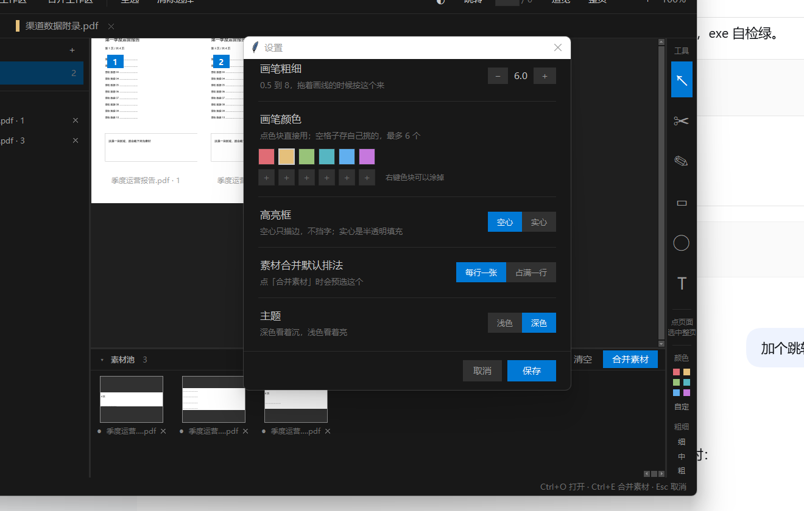
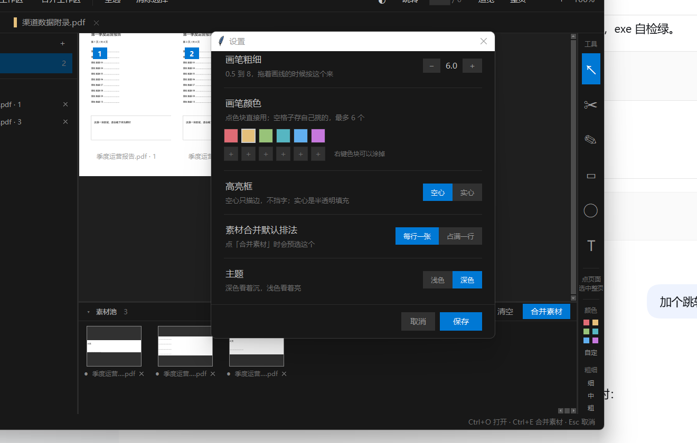

# PageBox · 页匣

**把散落在很多 PDF 里的那几页挑出来，攒成一册，拿去打印。**

一个 Windows 上的小工具，专门为"我要打印纸质材料"这件事做的。



---

## 为什么做这个

准备考研的时候，我手上是几十个 PDF：教材的某一章、某个机构的讲义、几篇论文、几道真题。我真正要背要练的，可能就散在这几十个文件里的十几页。

可在电脑上看是不行的。我需要**纸**——能在上面画、能夹进活页本、能翻到哪算哪。

于是就有了这个工具：把不同 PDF 里我要的页挑出来，攒成一本，打印。再后来加了裁切——讲义里只有一小块图有用，就把那一块裁下来，攒成一本"图册"。

市面上的 PDF 工具几乎都是**文件中心**的：打开一个文件，在它身上操作，存成一个新文件。我的活儿是**页面中心**的：手上有很多文件，我要的是"第 3 页这一页""第 12 页那块图"。

PageBox 就是按这个思路做的。

## 它能干什么

**挑页** — 打开 PDF 连续翻看，单击页面选中，攒进工作区。工作区最多开 4 个（比如"正文""附录""错题"），各存各的，关掉软件也不会丢。攒够了合并成一个 PDF。

**裁块** — 用裁切工具在页面上拖一个框，框可以拖着八个手柄调大小、可以整个挪位置，点「确定」才收进底下的素材池。裁下来的是**矢量**，不是截图，放大打印照样清楚。

**写笔记** — 页面上能画线、拉高亮框、打字、擦掉。六种笔色加自定义色槽，粗细可调。笔画是 PDF 坐标存的，缩放不走样，关掉再开还在。

**分类** — 给每个 PDF 挂一个标签，从它身上裁的块自动继承。素材池按标签筛选。

**拼册子** — 素材池攒够了，选一种排法合成 PDF：

- *每行一张*：适合大图，一张占满一行
- *占满一行*：小碎块一行排满再换行，省页数

**留给下次** — 打开过的文件都在左栏「最近打开」里，带时间、大小、标签。重新打开会跳回你上次看到的那一页，笔记原样都在。



## 下载

去 [Releases](../../releases) 下 `PageBox.zip`，解压，双击 `PageBox.exe`。

不需要装 Python，不用安装程序，整个文件夹拷到 U 盘里也能跑。

> 第一次运行时 Windows 可能弹「已保护你的电脑」——点「更多信息」→「仍要运行」。
> 这是因为 exe 没有买数字签名（一年几百块，一个免费工具不值当），不是有毒。

要求：64 位 Windows 8.1 以上。

## 上手三步

1. **打开**：把 PDF 拖进窗口，或者点左上角「打开 PDF」。
2. **挑页**：单击页面（左上角出现蓝色编号）→ 点「整页入工作区」。
3. **攒够了**：点「合并工作区」，存成新 PDF，去打印。

裁块就多一步：右边点 `✂`，在页面上拖个框，调好位置点「确定」，块就落到底下素材池了。

## 界面说明

| 位置 | 是什么 |
|---|---|
| 最左一列图标 | `▤` 打开的 PDF（历史记录）、`⊞` 工作区、`◈` 标签 |
| 顶部 | 工具栏 + 打开的文件标签页（左边那道色条是它挂的标签） |
| 中间 | 看 PDF 的地方 |
| 右边一列 | `↖` 选择 · `✂` 裁切 · `✎` 画笔 · `▭` 高亮 · `◯` 橡皮 · `T` 打字 · `⚙` 设置 |
| 底下 | 素材池，裁下来的块都在这儿 |

顺手记几个键：`Ctrl+O` 打开 · `Ctrl+G` 跳页 · `Ctrl+B` 收侧栏 · `Ctrl+Z` 撤销一笔 · `Ctrl+E` 合并素材。

`Ctrl+滚轮` 缩放，**按住中键拖动**可以平移页面。

## 它是怎么存的

所有东西都在程序目录下的 `data/workspace.json` 里，一个几百 KB 的 JSON：打开了哪些文件、每个挂了什么标签、哪个文件的第几页裁了块、画了哪些笔画、工作区里攒了什么。

里面记的是**引用**（文件路径 + 页码 + 一块矩形），不是页面副本，所以攒一百个素材也不占地方。

代价是：源文件被挪走或者删掉，那块素材就取不出来了——素材池里会标出来。

## 从源码跑

```bash
pip install pymupdf tkinterdnd2 pillow
python app.py
```

需要 Python 3.9 以上。

想自己打包成 exe：

```bash
pip install --target _build_tools pyinstaller
rem 然后双击「打包成 exe.bat」，或者照着里面的命令跑
```

`vendor/` 目录是给"不想装依赖、直接跑 exe"的场景准备的，不是必须。它已经被 `.gitignore` 排除。

## 文件结构

```
app.py       界面：布局、查看器、裁切、素材池、设置
store.py     数据：标签、素材、工作区、笔记，存档读写
pdflib.py    PDF：开文档、画页面、裁块、合并
theme.py     深色 / 浅色两套配色
tests/       验收脚本
```

跑一遍验收：

```bash
python tests/smoke.py
```

80 多项检查，覆盖合并顺序、裁切坐标换算、素材继承标签、拖动排序、设置存盘这些。改完代码先跑它。

## 已知的限制

老实说在前面：

- **只在 Windows 上跑过**。用了 Windows 的 DPI API 和 OLE 拖放，搬到 macOS / Linux 要改。
- **画笔没有压感**。压感要数位板那套 API，Tk 给不了。
- **没有阅读器的常见功能**：书签、目录跳转、搜索、选中文字复制。它就干一件事——挑页、裁块、合并。
- **合并素材只有两种排法**，页边距和纸张大小（A4 纵向）写死的，不能改。
- **笔记不会写回你的原 PDF**，也**不会进合并出来的 PDF**。它们是 PageBox 自己的一层，只在 PageBox 里看得见。

## 许可

MIT，随便用、随便改。见 [LICENSE](LICENSE)。
